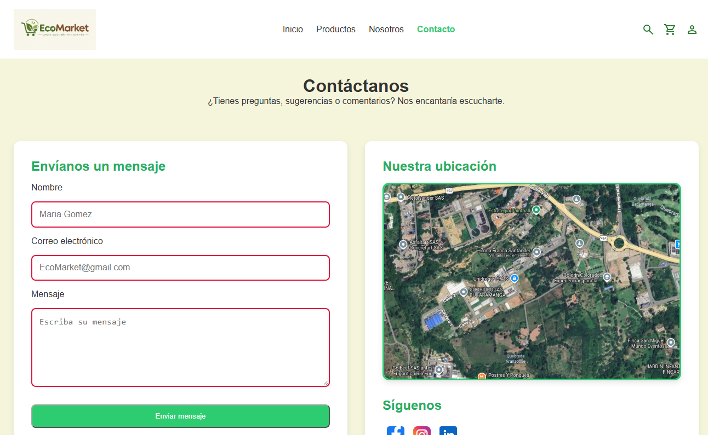
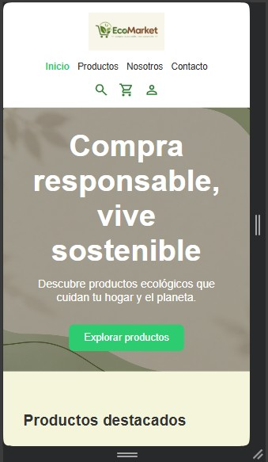

# 🌱 EcoMarket

## 📖 Descripción del proyecto

EcoMarket es una página web dedicada a la promoción y comercialización de productos ecológicos y sostenibles. El sitio permite a los usuarios explorar un catálogo de productos organizados por categorías, consultar información relevante sobre cada artículo y conocer la filosofía de la marca.

---

## 🚀 Instrucciones de visualización

La aplicación se encuentra desplegada en línea mediante GitHub Pages y puede visualizarse desde cualquier navegador web a través del siguiente enlace:

**link**

No requiere instalación ni configuraciones adicionales.

---

## 🌐 Despliegue

El proyecto fue publicado utilizando **GitHub Pages**, permitiendo su acceso público desde cualquier dispositivo con conexión a Internet.

---

## 🛠️ Tecnologías utilizadas

### HTML5
utilizado para estructurar el contenido de la página web, incluyendo secciones, formularios, enlaces e información de los productos.

### CSS3
Lenguaje de estilos empleado para diseñar la interfaz, definir colores, tipografías, espaciados y mejorar la presentación visual del sitio.

### Flexbox
Módulo de CSS utilizado para organizar elementos en filas y columnas de manera flexible, facilitando la alineación y distribución de componentes.

### CSS Grid
Sistema de diseño bidimensional utilizado para construir estructuras complejas y adaptables, especialmente en el catálogo de productos y las diferentes secciones de la página.

### Media Queries
Técnica de CSS que permite adaptar el diseño a distintos tamaños de pantalla, garantizando una experiencia adecuada en dispositivos móviles y de escritorio.

### Git
Sistema de control de versiones utilizado para registrar y gestionar los cambios realizados durante el desarrollo del proyecto.

### GitHub
Plataforma utilizada para alojar el repositorio, gestionar las ramas del proyecto y mantener el historial de cambios.

### GitHub Pages
Servicio de despliegue utilizado para publicar el sitio web y hacerlo accesible en internet mediante una URL pública.

---

## 📁 Estructura del proyecto

```text
EcoMarket_AngiePadilla/
│
├── index.html
├── README.md
│
├── css/
│   ├── main.css
│   ├── layout.css
│   ├── components.css
│   └── animations.css
│
├── img/
│   ├── hero/
│   └── icons/
│   └── products/
│   └── capturas/
│
└── views/
    ├── productos.html
    ├── sobre-nosotros.html
    └── contacto.html
```

---

## ✨ Funcionalidades principales

- Página de inicio con presentación de la marca.
- Catálogo de productos ecológicos.
- Barra lateral de filtros.
- Búsqueda de productos.
- Etiquetas de disponibilidad de stock.
- Botón de favoritos mediante pseudoclases CSS.
- Diseño adaptable para dispositivos móviles, tabletas y escritorio.
- Navegación entre distintas vistas del sitio.
- Organización modular de estilos CSS.

---

## 📱 Diseño Responsive

La interfaz fue desarrollada siguiendo principios de Responsive Design, permitiendo una correcta visualización en diferentes tamaños de pantalla mediante el uso de Media Queries, Flexbox y CSS Grid.

---

## 📸 Capturas de pantalla

### 🖥️ Vista de escritorio

#### Página de inicio


#### Catálogo de productos


#### Página Nosotros


#### Página Contacto



---

### 📱 Vista móvil

#### Página de inicio



#### Catálogo de productos


#### Página Nosotros


#### Página Contacto


---

## 🔀 Control de versiones

El proyecto fue gestionado utilizando Git y GitHub mediante una estructura basada en ramas de características:

```text
main
│
├── feature/refactor-css
├── feature/catalogo
├── feature/nosotros
├── feature/contacto
├── feature/home
└── feature/readme
```

Además, se empleó la convención Conventional Commits para documentar el historial de cambios.

Ejemplos:

```text
style: refactorizar estructura CSS
docs: agregar documentación del proyecto
```

---

## 👨‍💻 Autor

**Angie Padilla**

Proyecto académico desarrollado para la práctica y aplicación de HTML5, CSS3, diseño responsive y control de versiones con Git y GitHub.